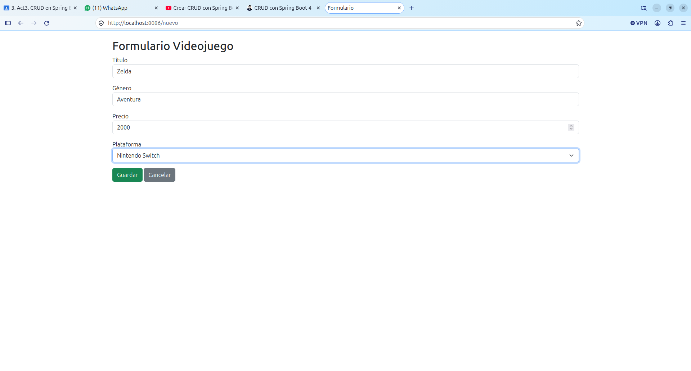
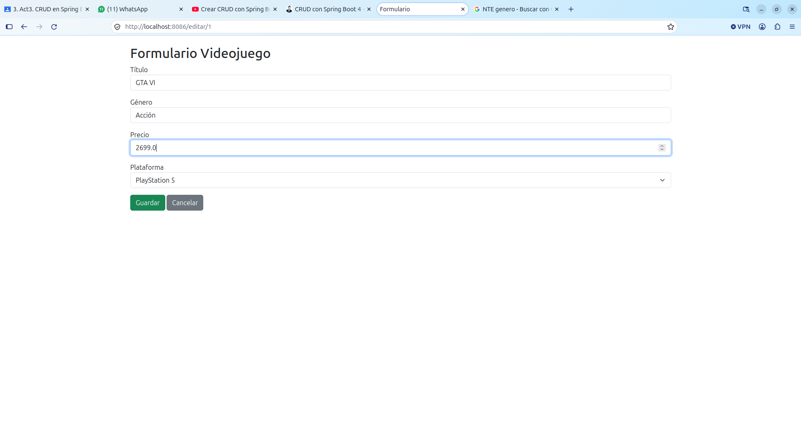
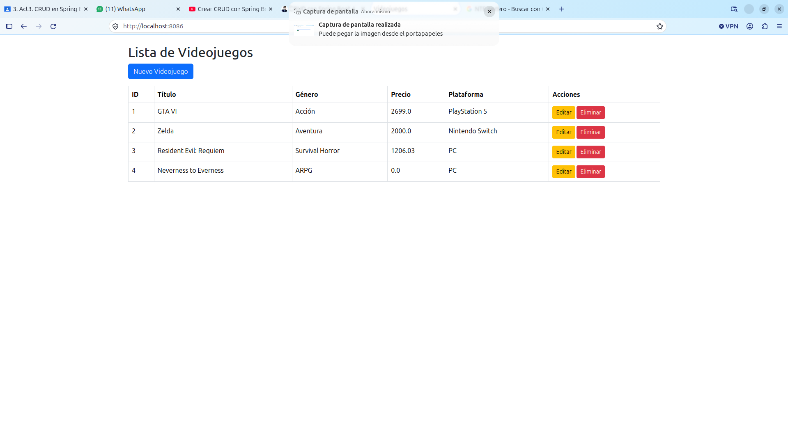
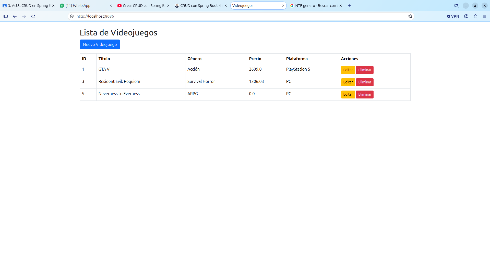
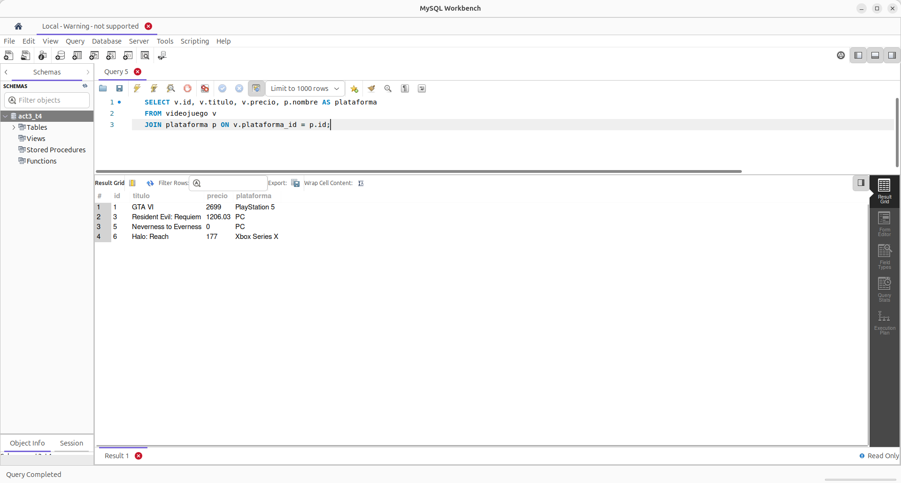
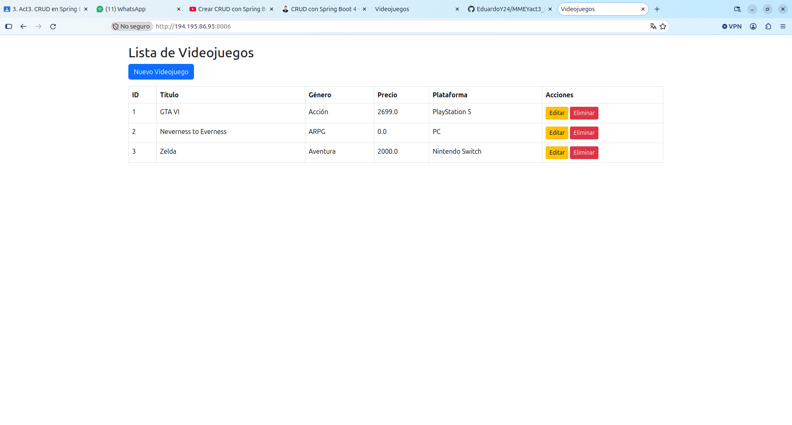

# MMEYact3_t4 - CRUD de Videojuegos con Spring Boot, JPA y MySQL

Proyecto de la Actividad 3 del Tema 4. Es un CRUD de videojuegos conectado a una base de datos MySQL, con dos entidades relacionadas (Videojuego y Plataforma). Las vistas están hechas con Thymeleaf dentro del mismo proyecto.

**Alumno:** Mendoza Martínez Eduardo Yael

## Proyecto en el VPS
Corre en el puerto **8086**: http://194.195.86.95:8086/

Las actividades anteriores siguen corriendo en sus puertos: Actividad 1 en el 8082 y Actividad 2 en el 8084.

## Tecnologías
- Java 21
- Spring Boot 4.1.2 (Spring Web, Spring Data JPA, Thymeleaf)
- MySQL 8.4

## Entidades y relación

| Entidad | Campos | Relación |
|---|---|---|
| `Plataforma` | id, nombre | `@OneToMany(mappedBy = "plataforma")`: una plataforma tiene muchos videojuegos |
| `Videojuego` | id, titulo, genero, precio | `@ManyToOne` + `@JoinColumn(name = "plataforma_id")`: muchos videojuegos pertenecen a una plataforma |

La columna `plataforma_id` de la tabla `videojuego` es la llave foránea hacia `plataforma(id)`. En la lista se muestra el nombre de la plataforma, no su id.

## Estructura (separación de capas)

```
models/       Videojuego, Plataforma          (entidades JPA)
repository/   VideojuegoRepository, PlataformaRepository   (extienden JpaRepository)
service/      VideojuegoService, PlataformaService         (lógica de negocio)
controllers/  VideojuegoController            (recibe las peticiones y regresa vistas)
templates/    index.html, form.html           (vistas Thymeleaf)
```

El controller nunca usa el repository directamente, siempre pasa por el service.

## Endpoints

| Método | Ruta | Operación |
|---|---|---|
| GET | `/` | Leer: lista de videojuegos con su plataforma |
| GET | `/nuevo` | Formulario para crear |
| POST | `/guardar` | Crear o actualizar |
| GET | `/editar/{id}` | Formulario para editar |
| GET | `/eliminar/{id}` | Eliminar |

## Capturas

### Crear


### Leer (la plataforma se muestra por nombre)


### Actualizar
Formulario con los datos cargados:



Resultado (GTA VI cambió de 2599 a 2699 y conserva su id):



### Eliminar
Zelda (id 2) ya no aparece:



### Lista final


### Relación en MySQL
Consulta con JOIN usando la llave foránea `plataforma_id`:



### Funcionando en el VPS


## Base de datos

Crear la base y el usuario:

    CREATE DATABASE act3_t4;
    CREATE USER 'eduardo'@'localhost' IDENTIFIED BY 'tu_contraseña';
    GRANT ALL PRIVILEGES ON act3_t4.* TO 'eduardo'@'localhost';

Las tablas las crea Hibernate al arrancar (`spring.jpa.hibernate.ddl-auto=update`). Después de la primera ejecución se insertan las plataformas:

    INSERT INTO plataforma (nombre) VALUES ('PlayStation 5'),('Xbox Series X'),('Nintendo Switch'),('PC');

## Credenciales

La contraseña de la base de datos no está en el repositorio. En `application.properties` aparece como `${DB_PASSWORD}`:

- En local se lee de un archivo `secrets.properties` (en la raíz del proyecto), que está en el `.gitignore`.
- En el VPS se pasa como variable de entorno: `export DB_PASSWORD=...`

## Cómo correrlo en tu compu
Crea `secrets.properties` en la raíz con `DB_PASSWORD=tu_contraseña` y luego:

    ./mvnw spring-boot:run

Abre http://localhost:8086/

## Cómo generar el .jar y correrlo en el VPS
    ./mvnw clean package
    export DB_PASSWORD='tu_contraseña'
    nohup java -jar mmeyact3_t4-0.0.1-SNAPSHOT.jar > app.log 2>&1 &
